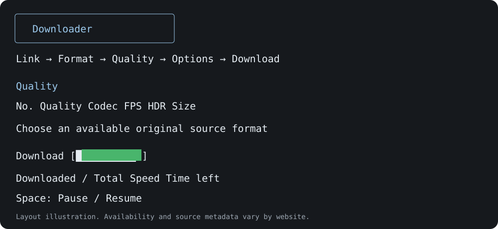

# Downloader

[](https://github.com/bablu637863-oss/downloader/actions/workflows/checks.yml)
[Download latest release](https://github.com/bablu637863-oss/downloader/releases/latest) · [हिंदी setup guide](docs/SETUP-HINDI.md) · [Help](docs/TROUBLESHOOTING.md) · [Report a bug](https://github.com/bablu637863-oss/downloader/issues/new/choose)



A terminal media downloader for **macOS and Windows**. Paste a supported link, choose an output format and source quality, optionally choose extras, and download.

The interface uses Hindi/Hinglish and English. Mobile apps and a web interface are not included in this release.

## Features

- Supported website URLs, direct media URLs, selected playlist items and multiple links through yt-dlp.
- MP4, MKV, WebM, MP3, M4A, WAV and FLAC output; available captions can be exported as text.
- Resolution, source codec, FPS and HDR choices when the source supplies them. Selected video streams are preserved; no automatic video re-encoding.
- Combined video/audio source sizes when known, sorted largest first. **Unavailable means no reliable size is supplied**. Converted audio sizes are not guessed. Final container size can differ from source payload size.
- Solid green progress, downloaded/total size, speed and elapsed time. **Space pauses/resumes** the download process; Ctrl+C opens the pause/cancel controls.
- Optional thumbnail, trim, filename, captions and source-specific options. Interactive arrow-key trim controls on both Mac and Windows, with typed start/end time fallback.
- Resume data, download history and local settings; validation with FFmpeg/ffprobe before reporting success.

Website support is determined by yt-dlp and the website. Public reels/stories/video/audio work only when the extractor supports the URL and access is allowed. Private content may need your own browser login. No guarantee for every site, DRM, active live streams, photos, chat backups or whole accounts.

## Quick setup — Mac and Windows

1. Open **[Latest Release](https://github.com/bablu637863-oss/downloader/releases/latest)** and download the ZIP for your OS. Extract the entire folder to a stable location.
2. Install **Python 3.10+**, **FFmpeg/ffprobe**, and **Deno** if missing. Setup reports missing tools instead of silently claiming success.
3. **Mac:** open `Setup.command`. **Windows:** open `Setup.cmd`.
4. Open a **new terminal** and type `yt` or `dd`. Or open `Start.command` / `Start.cmd` directly.

Windows accepts uppercase `YT` / `DD`; the Mac setup also provides mixed-case launchers. These are local user commands, not system-wide admin installs. Existing shell aliases are preserved. Keep the extracted folder in place; after moving it, rerun setup.

### macOS prerequisites

With [Homebrew](https://brew.sh/):

```sh
brew install python ffmpeg deno
```

The Mac setup can offer to install missing FFmpeg/Deno tools through existing Homebrew. Homebrew itself is not installed automatically. If double-click permissions prevent launching a `.command` file:

```sh
chmod +x *.command yt dd
./Setup.command
```

### Windows prerequisites

Use Windows 10/11 and Windows Terminal. Install [Python](https://www.python.org/downloads/windows/) and run these in a terminal if tools are missing:

```powershell
winget install --id Python.Python.3.13 --exact
winget install --id Gyan.FFmpeg --exact
winget install --id DenoLand.Deno --exact
```

Open a new terminal after installation. If `winget` is unavailable, use the official instructions: [FFmpeg Windows builds](https://ffmpeg.org/download.html), [Deno installation](https://docs.deno.com/runtime/getting_started/installation/). Packages are Python source bundles, not signed `.exe`/Mac applications; do not disable OS security protections.

### Manual / developer setup

```sh
python3 setup.py
```

On Windows use `py setup.py`. Add `--no-shortcuts` to install dependencies without changing user PATH or shell profiles. `python setup.py --check` checks required tools. Project launchers remain `./yt` / `./dd` on Mac and `.\yt.cmd` / `.\dd.cmd` on Windows.

## Everyday use

1. Start the launcher and paste a media link. Enter can use a supported link already in your clipboard.
2. Select the output format, then an available quality.
3. Optional settings appear once; press Enter to continue.
4. Press Enter at the final download prompt. Space pauses/resumes the transfer.
5. When successful, the saved folder is printed and opened.

At the home screen: `s` settings, `h` history, `u` update instructions, `q` quit. Set your own download folder, speed limit and cookie browser in settings. Download folder defaults to your home Downloads folder. Cookies are read locally only when you enable the option.

## Update

Replace the project source files with the latest repository version, then run `python3 setup.py` (Mac) or `py setup.py` (Windows) again. This updates dependencies in this project's virtual environment. Re-run setup from the new stable location to refresh commands. Settings and history are kept separately in `~/.downloader` (Windows: `%USERPROFILE%\.downloader`).

## Data and troubleshooting

- Each user runs their own installation. There is no hosted service or central upload of your downloads.
- Settings, history and redacted diagnostic JSON stay in the user's `.downloader` folder. Never upload that folder or cookie files to GitHub.
- Interrupted downloads keep resume data under the output folder. Server support determines whether a later transfer can resume.
- Some platforms omit FPS, HDR, duration or complete source sizes. Missing metadata is not invented.
- Font shaping depends on the terminal and installed fonts. Use a Unicode-capable monospaced font; no system font/profile is changed by setup.
- Not all codecs/HDR formats play in every player. A compatible player may be needed; the selected video stream is not silently changed to another codec.
- Windows support includes process-tree pause/resume and pipe handling. Automated checks run on Mac and Windows; see the **Actions** tab for actual results. Do not assume a particular Windows version/site works before checking those results and a local download.

Dependencies and technical details: [yt-dlp installation](https://github.com/yt-dlp/yt-dlp/wiki/Installation), [YouTube EJS/runtime support](https://github.com/yt-dlp/yt-dlp/wiki/EJS), [psutil process controls](https://psutil.readthedocs.io/stable/).

Use only for content you own or are permitted to download. This project is independent of yt-dlp and the supported websites.

## Releases, tests and license

Release ZIPs contain an explicit list of source/setup/docs files; virtual environments, cookies, history and local diagnostics are excluded. `SHA256SUMS.txt` is attached for download-integrity checks. [Changelog](CHANGELOG.md) · [MIT license](LICENSE).

Desktop checks run on macOS and Windows with Python 3.11/3.13. Release checks also generate a local audible video fixture and run an actual FFmpeg/yt-dlp download through localhost: no account/cookies or external-site guarantee. Check Actions for the result of each revision.
